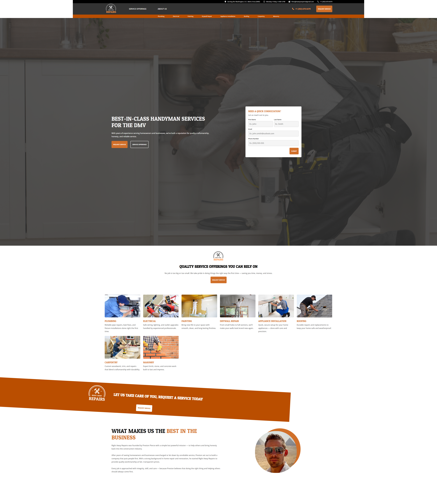
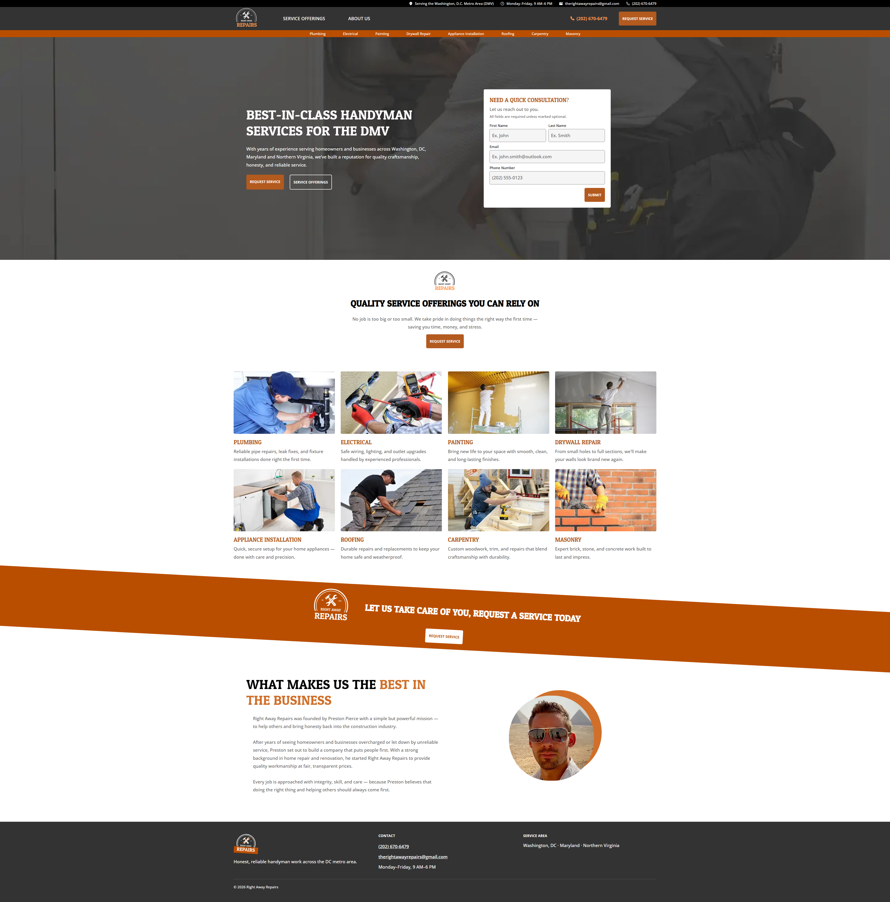
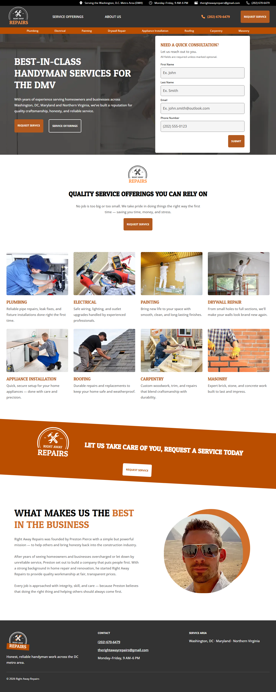
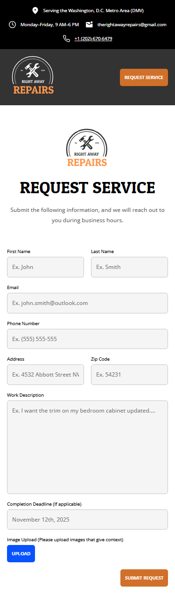
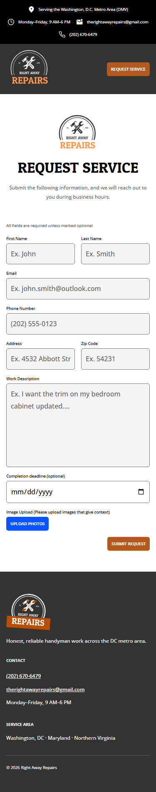

# Right Away Repairs: before and after

The live site is a static marketing page with two lead forms for a handyman business in the DC metro area.
"Before" is the site as committed at `61032a1`. "After" is the current `audit-fixes` working tree.
All numbers were measured on 2026-10-01 with the scripts in `scripts/`, unless a row says otherwise.

## Summary

| Metric | Before | After |
| --- | --- | --- |
| axe violations (WCAG 2.2 A/AA rules, 375 and 1440 wide) | 2 rules per page (40 failing nodes at 1440) | 0 on every page |
| WCAG success criteria failing | 10 | 0 |
| Lighthouse Accessibility / Best Practices / SEO | 78 / 96 / 82 | 100 / 100 / 100 |
| Lighthouse Performance, mobile (index) | 79 | 94 |
| Image bytes downloaded by the home page | 2,058 KB | 242 KB (−88%) |
| CSS files / `@import`s | 8 / 9 (3 levels deep, 1 a 404) | 4 / 0 |
| Inline JS lines | 625 | 427 |
| Content width at 1919 → 1920 px | 1799 → **1360** px (drops 439 px) | 1651 → 1651 px |
| Hero overflow at 1280×600 | form spills **73 px** out of the hero | fits, 9 px to spare |

## Accessibility

### axe-core

`node scripts/qa.mjs axe` runs the wcag2a, wcag2aa, wcag21a, wcag21aa and wcag22aa tags at 375×812 and 1440×900.

| Page | Before (rules: nodes @375 / @1440) | After |
| --- | --- | --- |
| `index.html` | `color-contrast` 13 / 13, `image-alt` 17 / 18 | 0 |
| `serviceRequest.html` | `color-contrast` 2 / 2, `image-alt` 6 / 7 | 0 |
| `thank-you.html` | (page did not exist; forms used `alert()`) | 0 |

### WCAG 2.2 success criteria

axe only finds about a third of these. The rest came from manual review and the `keys`, `forms` and contrast checks.

| Criterion | Before | After |
| --- | --- | --- |
| 1.1.1 Non-text Content | Icons and logos had no `alt` (18 images) | Decorative images have `alt=""`; the logo and founder photo are named |
| 1.3.1 Info and Relationships | Field labels and top-bar text were `<h4>`s; no `<label>`s, lists or `<nav>`; two `<h1>`s on the home page | Real `<label for>`, `<ul>`s, `<nav aria-label="Main">`, one `<h1>` per page, headings in order |
| 1.3.5 Identify Input Purpose | No `autocomplete` | `given-name`, `family-name`, `email`, `tel`, `address-line1`, `postal-code` |
| 1.4.3 Contrast (Minimum) | White on `#D1702A` buttons: 3.46:1 | White on `#B35A1F`: 4.77:1; every text pair ≥ 4.5:1 |
| 1.4.11 Non-text Contrast | Field border `#C6C6C6`: 1.7:1, the field's only edge | `#767676`: 4.54:1 |
| 2.1.1 Keyboard | Nav links were `<a>` with no `href`; navigation ran through click handlers | Real `<a href>`s throughout; works with JavaScript off or the CDN down |
| 2.4.2 Page Titled | Both pages shared one 211-character sentence as the title | Unique, descriptive titles |
| 2.5.3 Label in Name | Inputs were named by their placeholder ("Ex. John"), not the visible label | Name equals the visible label on every field |
| 3.3.2 Labels or Instructions | No programmatic labels; deadline was a free-text "tel" field | Labels, "(optional)" marking, a required-fields note, a native date input |
| 4.1.2 Name, Role, Value | `href`-less `<a>`s exposed no link role; "Request service" was a `<button>` that behaved as a link | Every control has a role and name (`qa keys` lists them) |

### Lighthouse

Lighthouse 13.5.0 in Playwright's Chromium, served from a local static server (no compression or cache headers).
Desktop uses `--preset=desktop`; mobile uses the default emulation. Each score is the median of 3 runs.

| Page | Mode | Performance | Accessibility | Best Practices | SEO |
| --- | --- | --- | --- | --- | --- |
| `index.html` | desktop | 97 → **99** | 78 → **100** | 96 → **100** | 82 → **100** |
| `index.html` | mobile | 79 → **94** | 78 → **100** | 96 → **100** | 82 → **100** |
| `serviceRequest.html` | desktop | 99 → **99** | 78 → **100** | 96 → **100** | 82 → **100** |
| `serviceRequest.html` | mobile | 85 → **92** | 78 → **100** | 96 → **100** | 82 → **100** |

What still costs mobile performance points: render-blocking CSS and Google Fonts (about 1.5 s of simulated
savings), plus cache and compression headers, which belong to the host, not the code.

## Weight and code

### Images on the home page

These are the bytes downloaded while scrolling `index.html` top to bottom at 1440×900 (375×812 gives the same totals).

| | Requests | Bytes |
| --- | --- | --- |
| Before (PNG) | 18 | 2,058.3 KB (the hero alone was 809 KB) |
| After (WebP from `scripts/images.mjs`, lazy below the fold) | 19 (adds the footer logo) | 241.9 KB |

### CSS

| | Before | After |
| --- | --- | --- |
| Files | 8 | 4 (`tokens`, `base`, `primitives`, `components`, in cascade layers) |
| `@import`s | 9 in a serial chain: HTML → `style.css` → `boilerplate.css` → Google Fonts. One pointed at a file that doesn't exist (404). | 0. Four parallel `<link>`s. |
| Lines (non-blank) | 1,006 (820) | 1,200 (1,015) |

The line count went up because of the design tokens, comments, and new blocks: footer, thank-you page,
skip link, form errors and the upload preview, which used to be inline JS styles. In return,
`primitives.css` and `components.css` contain no hex, rgba or px values at all.

### JavaScript (inline)

| Page | Before | After |
| --- | --- | --- |
| `index.html` | 140 | 68 |
| `serviceRequest.html` | 485 | 359 |
| Total | 625 | 427 (−32%) |

The removed code was click-handler navigation, smooth-scroll emulation and the `alert()`-based feedback.
Links, CSS `scroll-behavior` and the thank-you page now do those jobs.

## Layout at large screens

`node scripts/qa.mjs measure` reports the content column width inside the hero.

| Viewport | Before | After |
| --- | --- | --- |
| 1919×1080 | 1799 px | 1651 px |
| 1920×1080 | **1360 px** | 1651 px |
| 2560×1440 | 2000 px | 1805 px |
| 3840×2160 | 2000 px, top bar only 2560 px wide | 1824 px; top bar and CTA band span all 3840 px |

Before, widening the window by a single pixel, from 1919 to 1920, made the column 439 px narrower, and the services grid
switched between 5, 4 and 6 columns. Now the column grows steadily with the type, which scales above 1536 px,
and the grid stays at 4 columns.

### Hero at 1280×600 (a 13" laptop after browser chrome)

| | Hero height | Form bottom vs hero bottom |
| --- | --- | --- |
| Before | 440 px | **+73 px**: the form ran into the next section |
| After | 560 px (`clamp(560px, 100svh − header, 960px)`) | −9 px: it fits |

## Screenshots

### 3840×2160, full page

| Before | After |
| --- | --- |
|  |  |

### 1280×600, full page

| Before | After |
| --- | --- |
|  |  |

### 375×812, service request form

| Before | After |
| --- | --- |
|  |  |
